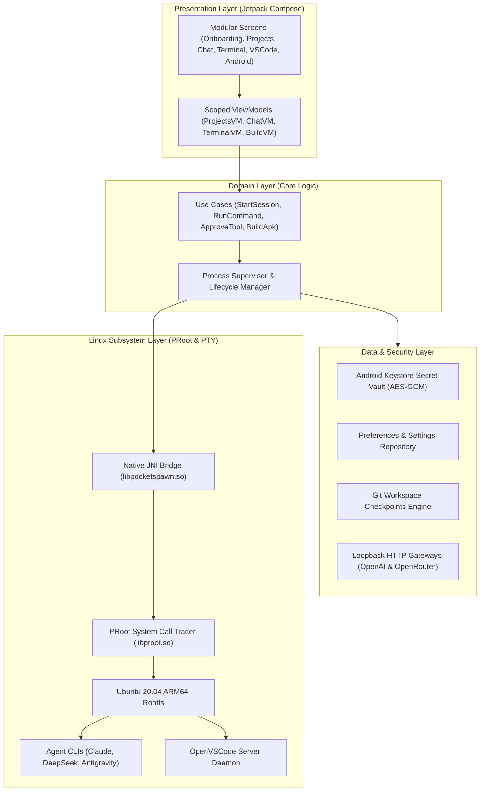

# System Architecture: PocketForge AI

## 1. High-Level Architectural Vision

PocketForge AI replaces the original monolithic codebase with a modern, modular **Clean Architecture** powered by **Kotlin**, **Jetpack Compose (Material 3)**, and a dedicated **Subsystem Native Layer**.



---

## 2. Recommended UI Stack & Justification

### Recommended Stack: **Kotlin 2.x + Jetpack Compose (Material 3)**
- **Why Compose over Traditional Views/XML:**
  - **Declarative State Reactivity:** Streaming AI reasoning tokens and live terminal outputs require frequent sub-second UI updates. Compose's smart recomposition skips unaffected layout nodes, keeping frame rates at a smooth 60 FPS.
  - **Adaptive Form Factors:** Compose's `BoxWithConstraints` and WindowSizeClass APIs make it trivial to split into dual-pane layouts on foldables and tablets.
  - **Native Android Lifecycle Integration:** Direct integration with `collectAsStateWithLifecycle()` ensures zero memory leaks when activities pause.
- **Why NOT Flutter or React Native:**
  - Cross-platform engines introduce heavy runtimes (~30 MB extra overhead), lack direct POSIX file descriptor passing via JNI, and introduce jank when embedding hardware-accelerated WebViews alongside terminal surfaces.

---

## 3. What to REUSE Almost Unchanged from Mobile Harness

To achieve ~92–95% functional parity without reinventing proven low-level mechanics, we will reuse the original core subsystem engine:

1. **The Native C Runtime Layer (`app/src/main/cpp/*`):**
   - `pocket_spawn.c`: Reused as-is for POSIX PTY allocation (`posix_openpt`, `ptsname`, `ioctl(TIOCSCTTY)`, `ioctl(TIOCSWINSZ)`).
   - `executable_carrier.c` & `CMakeLists.txt`: Reused for the ELF carrier packaging trick that allows PRoot executables to ship inside APK `jniLibs`.
   - `pocket_launcher.c`: Reused for dumpability settings (`prctl(PR_SET_DUMPABLE, 1)`) and unsetting Android `LD_PRELOAD`.
2. **Third-Party Submodules (`source/third_party/*`):**
   - `third_party/proot`: Reused with existing Termux compatibility patches (`fake_id0`, `link2symlink`, `sysvipc`).
   - `third_party/libandroid-shmem`: Reused for Android `/dev/ashmem` translation.
   - `third_party/talloc`: Reused as PRoot's memory allocator.
3. **Zstandard Streaming Extractor:**
   - The streaming pipeline in `RuntimeInstaller.kt` (`ZstdCompressorInputStream` -> `TarArchiveInputStream` -> POSIX file symlink creation) is retained with clean modular refactoring.
4. **Android Build Optimization Arguments:**
   - The Gradle build flags defined in `AndroidBuildSupport.kt` (`--no-daemon --max-workers=2 -Pandroid.aapt2FromMavenOverride=...`) are preserved verbatim.

---

## 4. Modular Folder Structure of the New Project

```text
pocketforge/
├── app/
│   ├── src/main/
│   │   ├── cpp/                        # Reused C/C++ native engine
│   │   │   ├── CMakeLists.txt
│   │   │   ├── pocket_spawn.c
│   │   │   ├── pocket_launcher.c
│   │   │   └── executable_carrier.c
│   │   ├── java/com/pocketforge/ai/
│   │   │   ├── core/                   # Common utilities, dispatchers, extensions
│   │   │   │   ├── BoundedStream.kt
│   │   │   │   └── DispatcherProvider.kt
│   │   │   ├── data/                   # Data sources & persistence
│   │   │   │   ├── keystore/           # Hardware Keystore Vault
│   │   │   │   │   └── ApiKeyVault.kt
│   │   │   │   ├── preferences/        # DataStore / AppPreferences
│   │   │   │   │   └── UserPreferences.kt
│   │   │   │   └── checkpoint/         # Git rollback manager
│   │   │   │       └── GitCheckpoints.kt
│   │   │   ├── domain/                 # Business logic & domain models
│   │   │   │   ├── model/              # Domain entities (Project, Agent, Profile)
│   │   │   │   └── supervisor/         # Background process monitoring
│   │   │   │       └── ProcessSupervisor.kt
│   │   │   ├── network/                # HTTP clients & translation proxies
│   │   │   │   ├── LocalFormatGateway.kt
│   │   │   │   ├── OpenRouterGateway.kt
│   │   │   │   └── GitHubClient.kt
│   │   │   ├── runtime/                # Subsystem, PRoot, and bridges
│   │   │   │   ├── installer/          # Rootfs download & extraction
│   │   │   │   │   ├── RootfsExtractor.kt
│   │   │   │   │   └── StackInstaller.kt
│   │   │   │   ├── bridge/             # Agent bridges
│   │   │   │   │   ├── ClaudeBridge.kt
│   │   │   │   │   ├── DeepSeekBridge.kt
│   │   │   │   │   └── AntigravityBridge.kt
│   │   │   │   ├── service/            # Foreground services & wake locks
│   │   │   │   │   └── RuntimeService.kt
│   │   │   │   └── vscode/             # OpenVSCode server controller
│   │   │   │       └── OpenVSCodeController.kt
│   │   │   └── ui/                     # Modular Jetpack Compose presentation
│   │   │       ├── screens/
│   │   │       │   ├── onboarding/     # 1-Tap Onboarding Flow
│   │   │       │   ├── projects/       # Projects List & Quick Chat
│   │   │       │   ├── chat/           # Agent Chat with Reasoning Drawer
│   │   │       │   ├── editor/         # In-App VS Code WebView
│   │   │       │   ├── terminal/       # Real Xterm/Termux Terminal View
│   │   │       │   ├── preview/        # Live Web Browser Preview
│   │   │       │   ├── android/        # Android Compilation Dashboard
│   │   │       │   └── developer/      # Developer Profile & Credits
│   │   │       ├── components/         # Reusable buttons, cards, diff viewers
│   │   │       └── theme/              # Obsidian & AMOLED Material3 palettes
│   │   └── res/                        # Drawables, layouts, strings
├── third_party/                        # PRoot, talloc, libandroid-shmem
├── docs/                               # Architecture and PRD documentation
├── build.gradle.kts
└── settings.gradle.kts
```

---

## 5. Unidirectional Data Flow (MVI Pattern)

All screen interactions follow a strict reactive cycle:

```
[User Action / Keystroke]
        │
        ▼
[UiIntent / Screen Action] ───► [ViewModel Execution via Coroutines]
                                        │
                                        ▼
[StateFlow<ScreenUiState>] ◄─── [ProcessSupervisor / RuntimeBridge Events]
        │
        ▼
[Compose Recomposition (Zero Jank)]
```
- **State Immutability:** UI state data classes are completely immutable (`val`).
- **Channel Events:** One-off alerts (Toasts, error snackbars, navigation events) travel via Kotlin `Channel<UiEvent>`.
